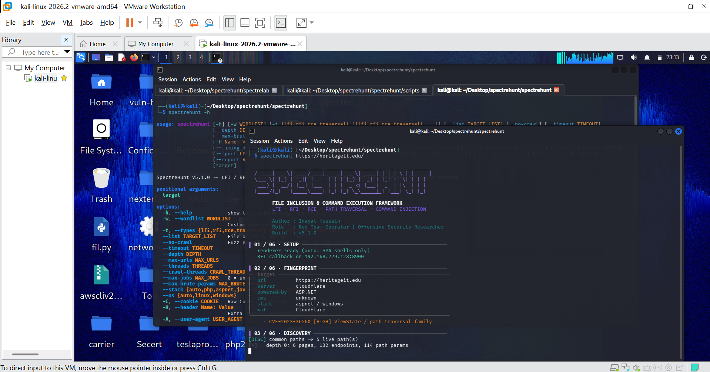

  

  # SpectreHunt

  **File Inclusion & Command Execution Framework**

  `LFI · RFI · RCE · PATH TRAVERSAL · COMMAND INJECTION`

  
  
  

  **Developed by Inayat Hussain**  
  Red Team Operator | Offensive Security Researcher

---

## Overview

SpectreHunt is a specialized Python-based framework for discovering, testing, validating, and investigating file inclusion and command execution vulnerabilities in web applications.

Designed around five core vulnerability classes, SpectreHunt combines automated endpoint discovery, technology fingerprinting, parameter fuzzing, payload mutation, response validation, and vulnerability-chain analysis in a unified command-line workflow.

### Core Vulnerability Classes

| Vulnerability | Focus |
|---|---|
| **LFI** | Local File Inclusion |
| **RFI** | Remote File Inclusion |
| **RCE** | Remote Code Execution |
| **Path Traversal** | Directory traversal and unintended file access |
| **Command Injection** | Unsafe operating-system command execution |

SpectreHunt also includes `spectrelab/`, a deliberately vulnerable PHP application for controlled testing and reproducible security research.

